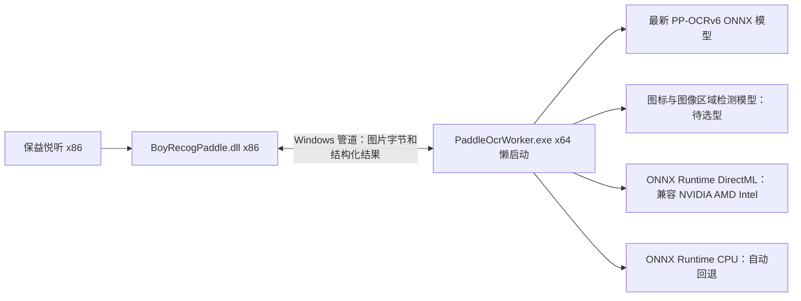

# 百度飞桨 识别插件架构

调研日期：2026-11-13。当前 x86 DLL、x64 det/rec worker、标准 Win32 设置及模型下载已实现并进行 ABI 集成测试；四档模型已有真实图片性能对照。方向识别、实际宿主/干净环境及图标/图像检测模型仍待验证。实施与测试细节见开发进度；下文保留架构依据。

## 1. 版本和依据

插件名称为 **百度飞桨**，插件版本为 **1.0**。软件发布版本与模型代际分开记录：PaddleOCR `v3.7.0`，PP-OCRv6。

通过 GitHub Release 和 API 核实，当前最新稳定发布是 2026-06-11 发布的 `v3.7.0`，提交 `b03f46425e8ff4442b268ce449e3eef758146cd4`；调研时 main 为 `dab3fe35379033fdcb2d0e9572fac0b36c9a9ebf`。实施使用固定稳定版本，不自动跟踪 main。[发布说明](https://github.com/PaddlePaddle/PaddleOCR/releases/tag/v3.7.0)

本地接口依据：`D:\projects\cpp\BoyReadingPCV2\Doc\保益识别插件开发说明.md`，SHA256 为 `DD82D03F9EF269230822C94ECA123CEE5451EE052CB1340F6213CFF37561E158`。同时检查了宿主 `SC/BoyOcr/BoyRecogPlugin.h`、`Plugin.cpp` 和 `PluginManager.cpp`。虽然文档开头说明不代表加载实现已完成，本地源码实际已有发现、版本资源读取、导出加载、能力过滤和回调复制逻辑；仍须在运行中的宿主验收。

旧项目 `D:\projects\cpp\baiduPaddleOcr` 使用 ONNX Runtime、OpenCV 和本地 HTTP 服务，识别线程数等存在固定设置。新版不继承旧服务和模型参数，主要依据最新官方模型配置及前后处理重新实现。

## 2. 总体结构

DLL 只承担 ABI、参数校验、进程与管道管理、UTF-16 回调。EXE 负责图像解码、设备选择、模型及前后处理。首版一个推理进程、一个在途请求，内部通过算子线程和文字行批处理利用资源；不引入跨请求调度框架。

宿主要求 x86 DLL，官方 Paddle C++ Windows 教程选择 x64。当前 ONNX Runtime 通用构建文档写明不再支持 32 位构建，但 DirectML 页面仍保留 x86 构建表述，两处存在版本口径差异，不能把某一版本 x86 可用性当成已验证结论。采用 x64 EXE 也避免模型占用宿主 32 位地址空间，并隔离推理崩溃。此方案要求 **64 位 Windows**。[Paddle Windows 部署](https://www.paddleocr.ai/main/version3.x/inference_deployment/local_inference/cpp/OCR_windows.html)、[ORT 构建说明](https://onnxruntime.ai/docs/build/inferencing.html)

## 3. ONNX 的取舍

仅做 NVIDIA/CPU 时不必转换；本项目明确要求三家 GPU 自动加速，因此选择 ONNX Runtime DirectML + CPU，Paddle 原生推理作为开发期准确性基线。首版不同时分发 Paddle、CUDA、TensorRT 等多套运行时。

DirectML 基于 DirectX 12，可覆盖三家兼容显卡；具体模型的算子、动态输入和驱动支持仍须验证。其维护状态为 sustained engineering，新功能转向 WinML；首版采用可随包部署的 DirectML 路线，后续按系统支持范围再评估 WinML。[DirectML 官方说明](https://onnxruntime.ai/docs/execution-providers/DirectML-ExecutionProvider.html)

优先检查官方是否提供可追溯的目标 ONNX 产物；当前已确认官方支持通过 PaddleX 的 Paddle2ONNX 插件转换。不要照抄文档示例的 opset 7：必须检查实际输出 opset、算子、动态维度与所锁定 DirectML 的兼容范围，转换器可能自动提高 opset。记录模型、字典、配置、转换工具版本、命令与 SHA256；用同一批输入对比 Paddle 原生、ORT CPU 和 DirectML 的框、文本及置信度。[官方转换指南](https://github.com/PaddlePaddle/PaddleOCR/blob/v3.7.0/docs/version3.x/inference_deployment/others/obtaining_onnx_models.md)

## 4. 模型和结果

默认选用 `PP-OCRv6_small_det` + `PP-OCRv6_small_rec`，随包提供；同一版本通过设置支持 PP-OCRv5 mobile 和 PP-OCRv6 tiny/small/medium，其他档位按用户选择下载。每档使用对应的 det/rec 配套模型和字典，不混配。插件只提供一个引擎 `PaddleOCR`；切档、设备回退不改变名称和能力标志，不因 GPU 不可用暗中换档。各档 ONNX/DirectML 兼容性仍须分别验收。

### 4.1 多版本识别逻辑

支持的组合为 PP-OCRv5 mobile 和 PP-OCRv6 tiny/small/medium。设置项和持久配置使用 `family + tier`，默认 PP-OCRv6 small，不能只保存 small 等档位名。

模型兼容不是路径替换：每个组合独立绑定官方权重、输入布局/尺寸、通道顺序、归一化、检测阈值及扩框参数、识别宽度策略、解码方式和字典。允许为实际存在差异的模型保留不同实现分支；只有经代码与样本验证一致的步骤才共用，不强制统一所有参数，也不预先建立通用后端插件框架。

加载时核查真实输入/输出名称、类型、维度和输出类别数，核对 blank、空格与字典索引。未知或不兼容模型明确失败，不猜测处理方法。tiny 等轻量模型也不能因同属 v6 就假定输出配置一致；模型清单与处理方式绑定，运行时不得任意加载不在清单中的模型。

每一组合分别验收真实图片、超长行、动态宽度与批量、CPU/GPU 执行、文字与框结果及性能；未通过验证的选项不能标记为可用。当前只有 v6 small 完成确定性张量执行验证，尚不代表任何组合已完成端到端识别验收。

### 4.2 设置接口和模型存储

实现新增可选导出 `int __cdecl BoyRecogSettings(const wchar_t* engineName)`。最新文档 §5.8 规定宿主在独立线程同步调用，设置窗口关闭后返回；正常关闭（包括取消）返回 0，取消不得保存修改。初始化后精确匹配 `PaddleOCR`，不用回调，不保留入参指针，设置窗口与识别配置访问需线程安全。宿主已有设置入口加载代码。当前接口文档 SHA256 更新为 `1DA12CCCF070A429F2DA8672821602B33457D60F3414D1323F20AC26DB63F3FB`（第 1 节旧哈希为初次调研快照）。

设置窗口由 x86 DLL 使用原生 Windows 对话框实现，提供有可访问名称的档位选择、下载状态、进度、取消和保存控件，支持键盘和读屏。打开窗口不启动推理 EXE；下载通过有界的工作线程执行，使用 Windows 原生网络能力，不增加网络运行库。关闭窗口前取消并回收下载线程，接口返回后不得残留执行 DLL 代码的线程。

下载显示当前模型及文件名、已下载/总大小、文件百分比和整套模型总进度。进度条配合可访问的文字状态，更新节流且不抢焦点；连接中、下载中、校验中、就绪、失败、取消分开呈现。大小以固定清单为准，不依赖服务器一定提供 Content-Length。下载到 100% 后仍显示校验状态，完整组合校验通过才允许保存选择；取消按钮在下载期间可操作。

| 用途 | 路径 |
| --- | --- |
| 随包默认模型 | `<插件目录>/models/PP-OCRv6/small/{det,rec}/` |
| 配置根目录 | `<文档目录>/BoyPcReader/plugins/Recognition/<插件目录名>/` |
| 下载模型持久缓存 | `<配置根目录>/models/<family>/<tier>/<revision>/{det,rec}/` |
| 用户设置 | `<配置根目录>/settings.ini` |

根据接口文档 §1.2，使用 `SHGetKnownFolderPath(FOLDERID_Documents, ...)` 获取实际文档目录，支持用户迁移及重定向，不硬编码用户路径。插件目录名取主 DLL 所在安装文件夹名，不能使用 DLL 文件名、ProductName 或引擎名；建议发布时固定为 `PaddleOCR`。重装、升级和卸载插件不自动删除配置根目录；安装文件夹更名会改变约定的配置路径，不应将此误判为缓存已丢失。

revision 固定一个档位的完整模型组合（权重、配置、字典）版本。每个 det/rec 目录有独立 `inference.onnx` 和 `inference.yml`，字典从同一版本配置提取或随模型配套提供。随包组合也由清单固定版本与哈希。读取时针对所选档位和版本，先验证配置目录的完整组合，再查安装目录中的同档位同版本组合；不跨根目录或版本拼接文件。DLL 解析出有效组合的绝对路径，通过管道交给 worker，不能依赖工作目录。下载仅写配置目录，不写 `dist` 或安装目录；两处均不可用时提示到设置修复，不静默换档或下载。

仅用户在设置中显式选择下载时联网，固定官方 HTTPS 来源、revision、大小和 SHA256；默认 small、初始化和 OCR 请求不联网。下载到缓存下临时目录，校验完整后再发布为就绪目录，失败/取消保留当前设置及可用模型。下载完成不等于保存设置；取消窗口不更改已选档位，可保留已经完整下载的缓存。多个宿主并发下载同一组合时需互斥，避免覆盖半成品。

保存时仅接受完整就绪档位，原子写入设置。当前识别继续使用请求开始时的配置快照；后续请求在串行边界关闭旧 worker，再按新档位懒启动，避免两套模型同时驻留。加载失败明确报错，用户可在设置中改回 small；不静默切档。持久设置指向缺失缓存时仍允许打开设置修复，不能因非默认档位缺失使整个插件无法加载。

图片按字节长度解码，必须支持 PNG；使用 OpenCV 的 core/imgproc/imgcodecs，保留官方 DB 后处理所需的多边形计算依赖。沿用 v3.7.0 算法和模型配置，而非旧版张量尺寸、字典或阈值。处理顺序为检测、框排序、透视裁切、识别批处理、CTC 解码和结果组装。首版关闭整页方向校正及去畸变，避免未实现的坐标逆变换；文字行方向模型是否增加由旋转文字样本验收决定。

纯文本和结构化接口共用同一结果集合；按阅读顺序输出，文本按行换行。文字四边形转换为外接矩形：左上向下取整、右下向上取整，再裁到原始图片范围，排除无效框。所有坐标回到原图，字符框没有可靠来源时传 `nullptr, 0`，不均分伪造。

唯一引擎 `PaddleOCR` 的目标基础能力为 OCR、自动 OCR、PDF OCR 和文字位置，即 `1 | 2 | 4 | 32 = 39`，各项实现并通过验收后声明。只有官方内置模型满足图标/图像检测要求、通过验收并核对宿主契约后才增加 `64`，合计 `103`；否则保持 `39` 并说明限制。不声明图片描述 `512/1024`、单图标语义识别 `8192` 或保留位。PDF 由宿主渲染成图片，插件不引入 PDF 库。

## 5. 自动设备与资源策略

首次请求启动后枚举实际适配器，排除软件适配器；不能固定选择 GPU 0。对候选 GPU 创建检测和识别会话，执行代表性预热并核实算子分配，避免把全 CPU 执行误报为 GPU。结合可用显存与实测耗时选择可用 GPU；无可用 GPU 时创建 CPU 会话。缓存选择结果，但模型、运行库或驱动变化后重新验证。

GPU 优先为强制策略：只要兼容 GPU 的模型加载和试运行成功，就使用 GPU。测速只在可用 GPU 之间选择并调整资源参数，不能因 CPU 更快而改用 CPU。CPU 仅作为无可用 GPU或 GPU 初始化/运行失败时的回退路径。

GPU 会话创建失败、设备丢失、显存不足或子进程异常退出时，销毁失败状态，在本次请求时限内切到 CPU 重试一次。回调前聚合完整结果，防止重试产生重复回调；CPU 也失败时返回非零，不把错误文字当结果。

CPU 依据进程实际可用处理器数量设置线程候选，用短时、有上限的基准测试选择线程数，保留宿主响应能力，避免 OpenCV 与 ORT 多层线程池过度并行。识别批量按文字行数量、宽度和内存预算调整，显存不足先减小批量；保留线程、批量、设备和超时覆盖项便于现场校准。充分利用资源不等于同时占满所有 GPU 或所有核心。

DirectML 会话按官方要求禁用 memory pattern、使用 `ORT_SEQUENTIAL`，同一会话不能并发 `Run`。内部 GPU 运算和行批处理仍可并行；不通过增加全局请求线程数绕过限制。候选尺寸和批量应有界，避免无限增长的动态形状缓存。[DirectML 会话约束](https://onnxruntime.ai/docs/execution-providers/DirectML-ExecutionProvider.html#configuration-options)

## 6. 管道、懒启动和退出

采用本机双向命名管道，限制当前用户、拒绝远程客户端，使用唯一管道名并核实连接进程身份。通过绝对路径和 `CREATE_NO_WINDOW` 启动自有 worker，不修改系统 PATH。进程加入启用 kill-on-close 的 Job Object，必要时挂起创建后入 Job 再恢复，避免启动竞态。

协议使用版本、操作码、请求编号、固定宽度长度字段和负载；显式编码整数，不直接发送 C 结构体。请求负载是图片编码字节，结果包含错误码、图片尺寸和文字项目（UTF-8 文本、原图矩形）；DLL 转 UTF-16。长度、项数、图片像素、整型溢出和完整读写均必须校验，协议上限在实现时按截图与 PDF 样本确定。首版不使用 JSON 库、HTTP、共享内存或磁盘图片中转。

生命周期：

1. `BoyRecogInit` 只记录 DLL 目录、检查必要文件及初始化状态，初始化成功不等于模型已可运行；`BoyRecogGetEngineList` 不启动 worker。
2. 首次有效执行请求在互斥保护下启动 worker，握手、设备探测、模型加载和识别有独立但有界的超时；后续复用。
3. worker 的管道 I/O 监测与推理执行分开，即使推理正在运行也能发现 EOF、`ERROR_BROKEN_PIPE` 或父进程退出；断开后立即发出退出信号，取消/终止推理并在限定时间内结束进程。不能只在下一次读取时检查断管。
4. DLL 在管道故障后使当前连接失效、回收进程句柄，下次请求允许懒重启。GPU 故障重启可指定 CPU，避免无限重试坏设备。
5. `BoyRecogUninit` 停止接收调用，关闭管道并等待 worker 退出，超时结束本插件拥有的 Job；关闭线程与句柄后返回，DLL 卸载后不能留下插件线程或回调。

所有回调在原调用线程、导出函数返回前完成；不在 IPC 线程上调用宿主。不要在 `DllMain` 做进程等待或模型操作。

## 7. 基于模型的图标与图像区域检测

用户明确要求准确定位并区分图标区域与图像区域，不要求理解图标含义或生成图片描述。区域检测属于结构化 OCR，不等于 `BoyRecogRecognizeIcon` 的单图标语义识别；后者及 `BoyRecogDescribeImage` 均不在本项目范围。

仅在 Paddle 官方内置检测模型支持时实现，不引入外部专用检测模型。禁止以 OpenCV 轮廓、连通域、边缘、尺寸或长宽比规则替代模型完成图标/图像分类；OpenCV 可用于解码、缩放、裁切及模型结果后处理。不额外增加第三方运行库，检测模型应复用 ONNX Runtime DirectML/CPU，模型和配置随离线包交付。

| 目标 | 输出 | 当前状态 |
| --- | --- | --- |
| 图标区域检测 | `BOY_RECOG_ITEM_ICON`（0）、原图矩形、空文本 | 必须选择能实际检测 UI 图标的模型，尚未验证 |
| 图像区域检测 | `BOY_RECOG_ITEM_IMAGE`（4）、原图矩形、空文本 | 官方布局模型可作为候选，仍须验证截图场景 |
| 文字识别 | `BOY_RECOG_ITEM_TEXT`（3）、文字及原图矩形 | PP-OCRv6 路线 |
| 图片描述、图标语义识别 | 不提供 | 不声明 `512/1024/8192`，不伪造带描述图标 |

已有官方布局模型证据见 [版面检测](https://github.com/PaddlePaddle/PaddleOCR/blob/v3.7.0/docs/version3.x/module_usage/layout_detection.md) 和 [版面分析](https://www.paddleocr.ai/latest/version3.x/module_usage/layout_analysis.html)。文档布局类别不能证明 UI 图标检测能力；不能将通用 image 类直接映射为 icon，也不能把文档布局精度当成桌面截图精度。核实官方内置模型类别及训练场景；若不能满足，明确记录能力缺口，不引入外部模型、不以启发式方案补位。

结构化结果在 worker 内合并文字、图标与图像，统一原图坐标和阅读顺序；IPC 项目必须增加固定宽度的项目类型字段。允许图像内部包含文字，不可简单因框重叠而删除文字。`includeOtherTypes=0` 仅运行文字链路；为 1 时才懒加载并运行区域检测模型。

验收需要人工标注的真实桌面/应用截图，覆盖小图标、不同 DPI、明暗主题、工具栏、照片、插画、图标旁文字及图内文字；分别统计两类的 precision、recall、定位 IoU 和混淆，并记录耗时与资源占用。模型未选定，不能承诺准确率；准确性不足不能用无依据的分类规则掩盖。

接口 `64` 合并了无描述图标、带描述图标和图片三类，而本需求只输出无描述图标和图片。实施前须核对这一子集是否符合宿主能力约定，不擅自修改外部接口。模型验证及契约确认前不声明 `64`；若官方内置模型确实不支持，则记录限制并不启用该能力。

## 8. ABI、构建与发布

DLL 使用文档原始签名、`extern "C"`、`__cdecl`、`pack(8)`，以 `.def` 导出 `BoyRecogInit`、`BoyRecogUninit`、`BoyRecogGetEngineList`、`BoyRecogOcrText`、`BoyRecogOcrItems` 和 `BoyRecogSettings`。设置接口不增加识别能力位。不支持的图片描述和图标函数不导出。精确匹配引擎名称，检查空参数和选项，异常不得越过边界；输出内存只在回调期间有效，双方不互相释放。

采用 VS2022 v143、C++17，DLL 和 worker 分别构建 Win32/x64，Release `/MD`、Debug `/MDd`。建议 CMake 作为唯一工程定义，分别生成 VS2022 工程。上游 C++ CMake 硬编码 `/MT`、`/MTd`、`libcmt`，不能直接使用；上游部分失败路径调用 `exit()`，不能复制进 DLL。[上游构建文件](https://github.com/PaddlePaddle/PaddleOCR/blob/v3.7.0/deploy/cpp_infer/CMakeLists.txt)、[预测器代码](https://github.com/PaddlePaddle/PaddleOCR/blob/v3.7.0/deploy/cpp_infer/src/modules/text_recognition/predictor.cc)

依赖通过 C API/明确所有权边界使用时也须验证 Debug 兼容性，不把 Release C++ 静态库强行链接到 `/MDd`。检查模型与第三方许可证，保留 Apache-2.0 等要求的声明；不照搬上游自动下载及可视化依赖。

`dist/` 为默认 small 可离线使用的完整发布根目录，布局见 [发布说明](dist/发布说明.md)。随包提供 small 模型、匹配字典、配置、运行库及许可；其他档位仅从设置窗口显式下载到独立持久缓存。打包前检查来源、哈希、位数、依赖闭包和版本资源，不能依靠开发机全局安装的库。

## 9. 实施顺序与验收

1. 固定 PP-OCRv6 模型、ORT/DirectML 和 OpenCV 版本；先在 x64 验证 ONNX CPU/三家 GPU 的实际算子兼容和精度。最低 Windows 版本、具体 opset 与可发布依赖包在此阶段确定，目前未实测。
2. 实现 x86 ABI 与 x64 管道 worker，覆盖懒启动、并发首次调用、断管中断、超时、崩溃恢复和卸载。最小宿主程序检查无修饰导出、资源、回调线程、次数和内存生命周期。
3. 对同一批中英文截图、透明 PNG、空白图、损坏图、超大图、旋转文本和 PDF 页面做 Paddle/ORT 对照；记录冷启动、热请求 P50/P95、峰值内存/显存及读屏响应，验证自动资源设置与 CPU 回退。
4. 在干净无网络机器上从 `dist/` 安装验收默认 small 和已下载档位，检查普通 OCR 缺失模型时明确失败、无隐式下载、管道断开自动退出。另验收设置下载取消/失败、哈希错误、空间不足、切档并发、插件重装后缓存和设置保留。GPU 矩阵未覆盖的设备明确列为未验证，不能以 CPU 成功替代三家 GPU 验证。

当前已下载并校验 v6 small，完成原生模型执行探针及开发期 Python 真实图片 det/rec 对照工具；尚未生成可运行插件。v5 测试模型仅存放在开发下载目录。实际测试记录见开发进度.md，不能把开发脚本耗时当作最终 C++ 插件耗时。

首版默认确定为 v6 small，可选 v6 tiny/small/medium 与 v5 mobile；v5 server 记录设为 `release_enabled: false`，仅保留历史测试追溯。发布与设置列表仅采用启用记录。下载清单随插件附带，通过插件升级更新，不联网获取清单；识别不等待或触发模型下载，模型不可用直接失败。所有输出坐标都以调用时的输入原图左上角为原点，内部缩放、方向旋转及裁切后必须逆变换回原图；方向模型接入及旋转图片验收仍待完成。
